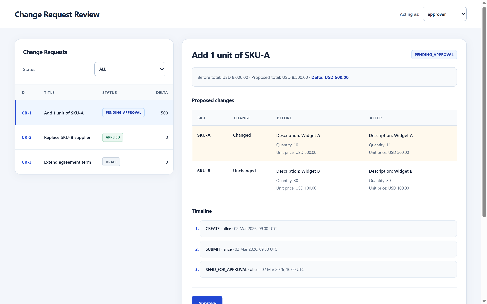
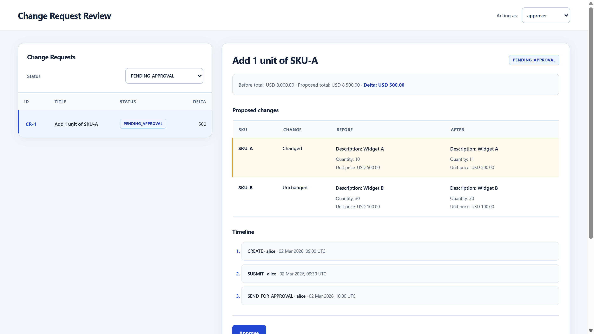
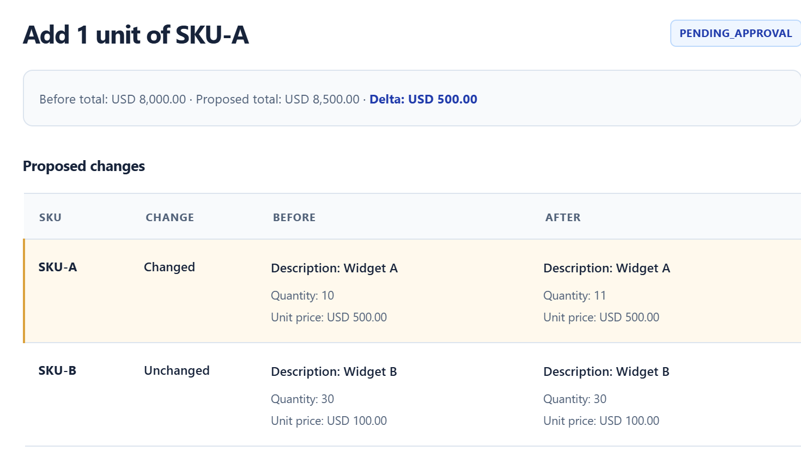
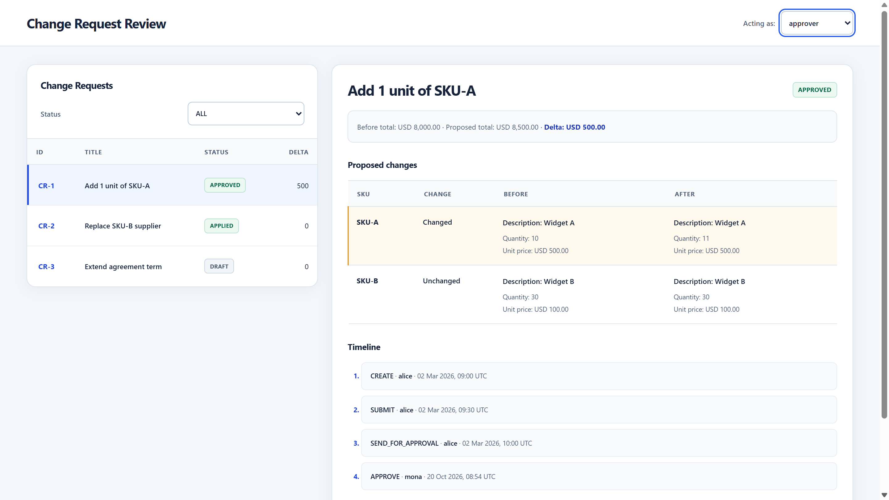
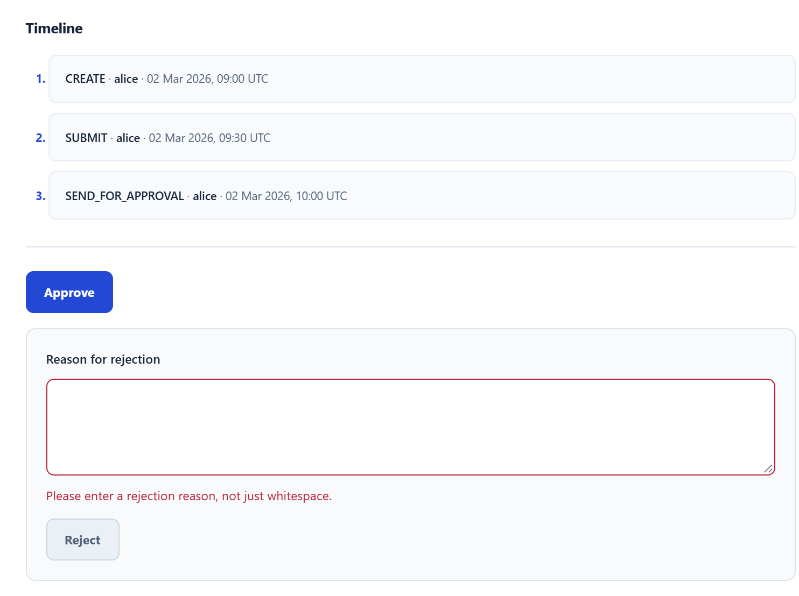
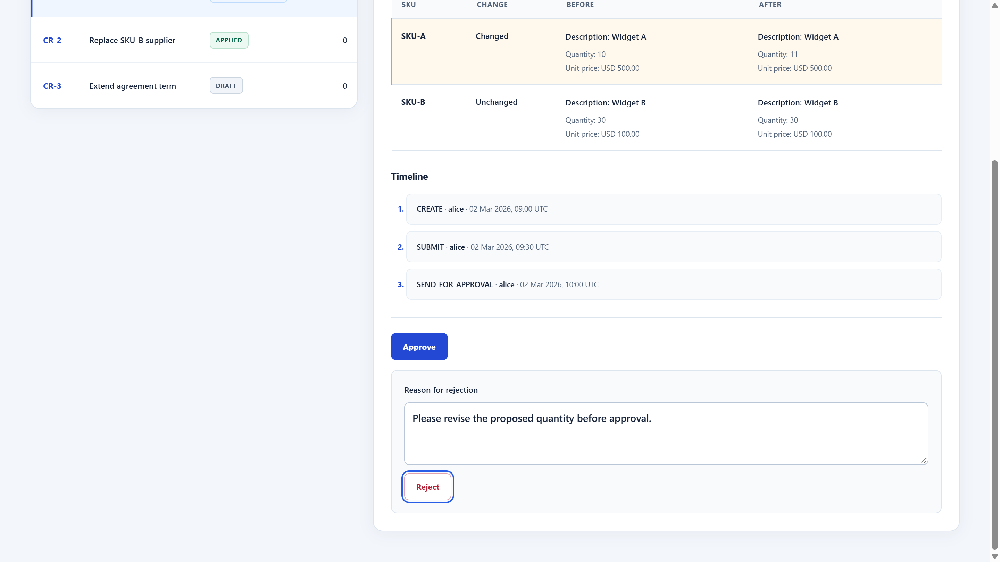
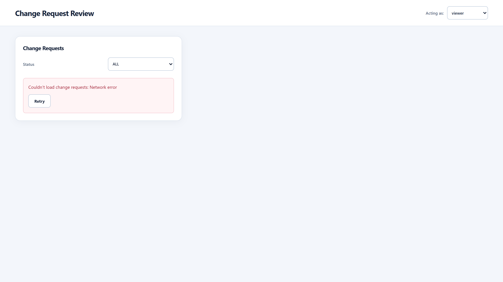
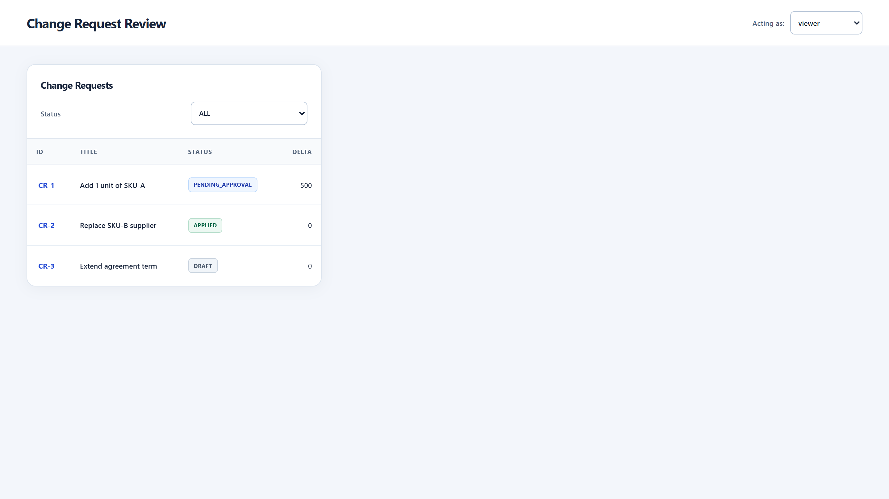
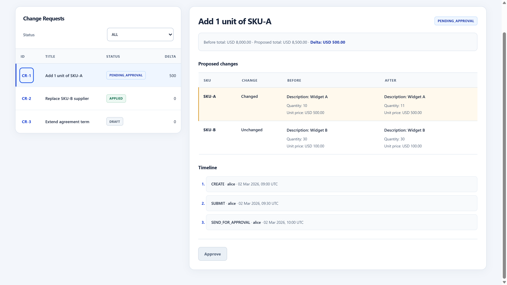
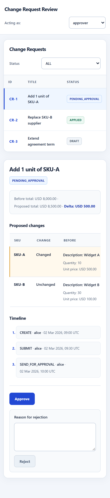

# Change Request Review Dashboard

An Angular application for reviewing proposed changes to Purchase Agreements: find a Change Request, compare its line items and financial impact, review its history, and approve or reject it.

## Overview

Built for the Penny AI frontend assessment, this project completes the supplied Angular scaffold against its organization-scoped **mock API**. No production backend is included.

The dashboard pairs a filterable Change Request List with a Detail panel. The **Acting as** switcher provides approver, read-only viewer, and other-organization fixtures for exploring permission-aware behavior.

## Key Features

- **Change Request List:** status filtering, persistent selected-row highlighting, and separate API-empty and filter-no-match messages. Filters preserve the loaded source data and selection.
- **Diff Preview and Totals:** added, removed, changed, and unchanged line items; before/after description, quantity, and unit price; baseline total, proposed total, and delta using the response currency.
- **Approval Timeline:** chronological events with stable ordering for equal timestamps, available actor/action/note metadata, and readable UTC dates that retain the original ISO value in `<time datetime>`.
- **Approve and Reject:** status and permission checks in both UI and handlers, trimmed nonblank rejection reasons, and a shared lock against duplicate or overlapping submissions.
- **Explicit Feedback:** loading, empty, error, retry, action progress, validation, and unknown-outcome states.
- **Async Safety:** stale-response and session guards, Detail reloads on selection changes, List refresh after confirmed status changes, and reconciliation reads without automatic mutation retries.
- **Responsive Presentation:** desktop and mobile layouts, contained table scrolling, native keyboard-accessible selection buttons, visible focus, and linked validation feedback.

## Screenshots

Real captures from the running application using the supplied mock fixtures. Application styles and fixture data were not edited for presentation; the approval result reflects an actual in-memory mock action.

### Dashboard overview

Desktop List, persistent selection, and Detail panel at a 1440 x 900 CSS viewport.



<details>
<summary>Status filtering</summary>

The active PENDING_APPROVAL filter shows the matching request while its Detail remains selected.



</details>

<details>
<summary>Change Request details and financial impact</summary>

CR-1 compares quantity 10 with 11: the total increases from USD 8,000 to USD 8,500, a USD 500 delta. Changed and Unchanged rows retain their before/after values. Existing fixtures do not include Added or Removed rows, so those categories are not pictured.



</details>

<details>
<summary>Approval, audit timeline, and rejection validation</summary>

**Confirmed approval:** CR-1 is APPROVED in both List and Detail, with a new APPROVE event in the chronological timeline. This action affected only the local mock store, which was reset afterward.



**Invalid rejection reason:** nonblank validation feedback appears and Reject is disabled. No action was submitted in this capture.



**Valid rejection reason:** entering a nonblank reason enables Reject. This image shows the prepared form, not a submitted rejection or a successful result.



</details>

<details>
<summary>Network error and retry recovery</summary>

The mock API's existing one-time failNext mechanism produces the real Network error state and Retry button; this is not a simulated image or a real backend outage.



Activating Retry loads the List successfully in the same viewer session, without repeating a mutation.



</details>

<details>
<summary>Read-only viewer role</summary>

A viewer can inspect the pending CR, diff, and history. Approve is disabled and no rejection form is shown. The capture is scrolled to the controls; frontend gating does not replace backend authorization.



</details>

<details>
<summary>Responsive mobile layout</summary>

Full-page capture from an approximately 390 x 844 CSS viewport. Wide tables retain horizontal scrolling within the panels.



</details>

## Tech Stack

| Area | Technology |
| --- | --- |
| Application | Angular 15.2.10, TypeScript, standalone components |
| Forms | Angular reactive forms |
| Testing | Jest, Angular TestBed, jest-preset-angular, jsdom |
| Presentation | HTML and CSS with system fonts; no external UI kit |
| Data | Supplied Promise-based mock API and fixtures |

## Getting Started

Use **Node.js 18.20.3** (`.nvmrc`). The verified npm version is **10.7.0**. The package engine range is `>=18.20.0 <19`; npm is not separately pinned.

Activate Node 18.20.3 with your preferred version manager or session-local runtime, then run from the repository root:

```bash
node -v
npm -v
npm ci
npm start
```

Open [http://localhost:4200](http://localhost:4200). Stop the development server with Ctrl+C.
Keep the supplied `package-lock.json` and `.npmrc` (`legacy-peer-deps=true`) for reproducible installation.

## Testing

```bash
npm test -- --runInBand
npm run typecheck
npm run lint
npm run build
```

**130/130 Jest tests across four suites passed** during verification of an isolated local Git clone at commit `395f898`, using Node 18.20.3 / npm 10.7.0 on the same Windows machine. Installation, typecheck, lint, and production build also passed. The development server returned HTTP 200, and a Chrome smoke test verified loading, selection, filtering, and action gating. These results do not represent GitHub CI or verification on another machine.

The suite covers rendered DOM, permissions, validation, diff classification, totals, timeline ordering, race conditions, and failing API responses. Deferred Promises and fake timers control race tests.

`npm run build` writes the production output to `dist/cr-review`; lint checks TypeScript. Optional scripts are `npm run test:watch` and `npm run format` (the latter rewrites TypeScript formatting).

## Architecture

| Component / Service | Responsibility |
| --- | --- |
| `AppComponent` | Owns selection, switches fixture users, and coordinates List/Detail updates |
| `CrListComponent` | Loads summaries, derives filtered rows, and emits selection |
| `CrDetailComponent` | Loads the selected CR, renders preview/history, and manages guarded actions |
| `CrApiService` | Supplies organization-scoped mock reads and transitions |
| `SessionService` | Holds the current fixture user |

App passes `selectedId` to List and Detail. List emits `select`; Detail emits `updated` after a confirmed status change so App can refresh List while retaining the filter and current selection. Component-local state and parent-child events avoid a global state library.

Shared utilities provide pure SKU-based diff classification, currency formatting, view states, and policy checks. See [Implementation Notes](./IMPLEMENTATION_NOTES.md) for lifecycle guards, reconciliation decisions, and edge cases.

## Known Limitations

- The supplied mock API is not a production backend. It can mutate the store before rejecting a Promise; failed responses require reconciliation, and some outcomes remain unknown.
- Frontend guards do not replace backend authorization. Ownership/workspace metadata and backend idempotency/concurrency guarantees are unavailable.
- The dependency audit reported **100 findings overall** and **2 High production-only findings**, with no Critical findings in the production-only report. Remediation is required before production use; production-only counts do not prove the generated browser bundle is secure. No dependency upgrades were applied.
- Browser smoke testing is not a comprehensive accessibility, cross-browser, or production-security audit.

## Documentation

- [Candidate Brief](./CANDIDATE_BRIEF.md): original scenario, requirements, acceptance criteria, and submission instructions.
- [Implementation Notes](./IMPLEMENTATION_NOTES.md): architecture, invariants, verification, trade-offs, production follow-ups, and **transparent ChatGPT/Codex assistance disclosure**.

## Assessment Submission

The brief explicitly requests:

- A Git repository with the full commit history, without squashing.
- Root-level `IMPLEMENTATION_NOTES.md`.
- A **5-8 minute walkthrough video** covering List and Detail, a rejection, an error state, and one non-trivial decision.
- Working `npm ci` and `npm test` from a clean clone.

The follow-up technical interview includes explaining the submitted implementation, making a live change, debugging behavior, and discussing a trade-off. AI assistance is permitted and disclosed in the implementation notes.
